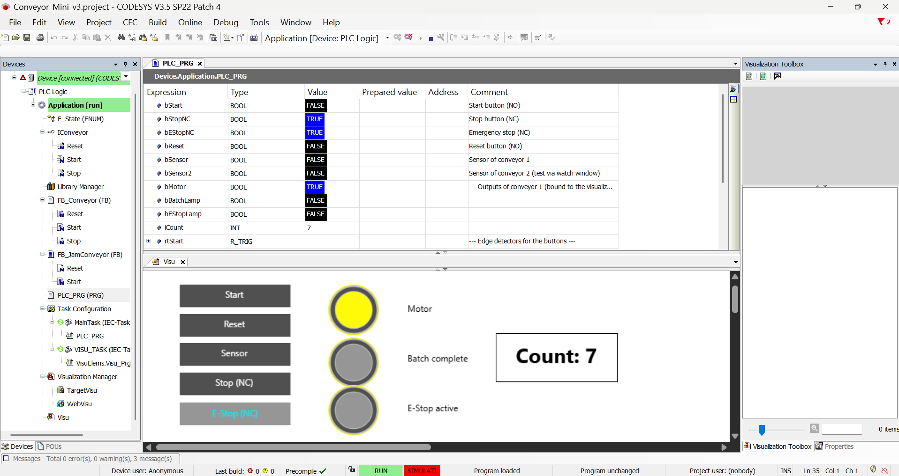
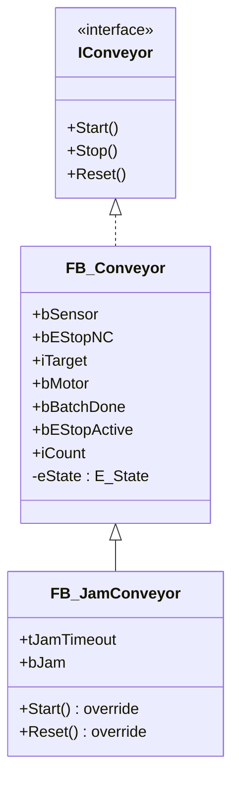

# Conveyor Control in CODESYS: an Object-Oriented IEC 61131-3 Mini-Project

A small, simulated conveyor control application written in **Structured Text (IEC 61131-3)** with **CODESYS V3.5 SP22 Patch 4**. It runs entirely in the CODESYS Soft PLC simulator, so no hardware or runtime license is needed.

The goal of the project was to get hands-on with PLC tooling and to apply **object-oriented programming concepts in a PLC environment**: encapsulation, interfaces, inheritance, method override and polymorphism.

> This is a short personal learning project, not a production-ready framework. See [Limitations](#limitations).



## Features

- Conveyor state machine: `IDLE`, `RUNNING`, `BATCH_DONE`, `ESTOP`
- Product counting with a configurable batch size
- Stop and emergency stop wired as **NC (normally closed)** inputs, as in real installations
- Emergency stop is **latched**: releasing the button does not restart the machine, a new reset is required
- Start and reset are **edge-triggered** (`R_TRIG`), so a held button never causes an unintended restart
- Jam detection in a derived conveyor type (motor running but no product detected within a timeout)
- Simple CODESYS visualization with push buttons and indicator lamps

## Architecture



`PLC_PRG` creates two instances (`Conv1 : FB_Conveyor`, `Conv2 : FB_JamConveyor`), stores them as `IConveyor` references in an array and sends commands to all of them in a single loop. The loop does not know which concrete type it is talking to.

### State machine

| State | Motor | Leaves the state when |
|---|---|---|
| `IDLE` | off | start pressed (and stop not pressed) → `RUNNING` |
| `RUNNING` | on | stop → `IDLE`; count reaches target → `BATCH_DONE` |
| `BATCH_DONE` | off | reset → `IDLE` |
| `ESTOP` | off | E-Stop released **and** reset pressed → `IDLE` |

The emergency stop has priority over every other state.

### OOP concepts used

| Concept | Where |
|---|---|
| Encapsulation | State (`eState`, counters, edge detectors) is private to the function block and controlled through methods |
| Instantiation | `Conv1` and `Conv2` are independent instances with their own state and batch size |
| Interface | `IConveyor` defines the common contract |
| Inheritance | `FB_JamConveyor EXTENDS FB_Conveyor` and reuses its state machine through `SUPER^` |
| Method override | `FB_JamConveyor.Start()` ignores start requests while a jam is latched; `Reset()` also clears the jam |
| Polymorphism | `PLC_PRG` drives an `ARRAY OF IConveyor` without knowing the concrete types |

## Inputs and outputs (conveyor 1, bound to the visualization)

| Variable | Direction | Description |
|---|---|---|
| `bStart` | input | Start button (NO), edge-triggered |
| `bStopNC` | input | Stop button (NC, `TRUE` in normal condition) |
| `bEStopNC` | input | Emergency stop (NC, `TRUE` in normal condition) |
| `bReset` | input | Reset button (NO), edge-triggered |
| `bSensor` | input | Product sensor, one count per rising edge |
| `bMotor` | output | Conveyor motor |
| `bBatchLamp` | output | Batch complete lamp |
| `bEStopLamp` | output | Emergency stop active lamp |
| `iCount` | output | Product counter |

Conveyor 2 has its own sensor (`bSensor2`). It has no visualization elements and is observed and stimulated through the CODESYS watch window.

## How to run

1. Install the free **CODESYS Development System V3** from the [CODESYS Store](https://store.codesys.com) (Windows only). Developed with V3.5 SP22 Patch 4.
2. Open `Conveyor_Mini.projectarchive` (`File → Project Archive → Extract Archive…`).
3. Enable `Online → Simulation`.
4. `Build → Build`, then `Online → Login` and `Debug → Start` (F5).
5. Open the `Visu` tab and use the buttons. For conveyor 2, write `bSensor2` in the `PLC_PRG` watch window.

## Tests performed

All tests were manual, in the simulator.

| Scenario | Expected result | Result |
|---|---|---|
| Start, then 10 sensor pulses (conveyor 1) | Counter reaches 10, motor off, batch lamp on | Pass |
| Reset after batch complete | Back to `IDLE`, counter cleared | Pass |
| E-Stop pressed while running | Immediate stop, E-Stop lamp on | Pass |
| E-Stop released without reset | Stays in `ESTOP` | Pass |
| Reset held down, then released E-Stop | No automatic restart | Pass |
| Start held down while resetting | No automatic restart (edge-triggered) | Pass |
| Conveyor 2 running with no product for 5 s | `bJam` set, motor stops, conveyor 1 unaffected | Pass |
| Start while jam is latched | Ignored (override) | Pass |
| Reset, then Start | Conveyor 2 runs again | Pass |
| Conveyor 2 reaches 5 products | `BATCH_DONE`, no false jam afterwards | Pass |

## Lessons learned

- **Overrides depend on exact names.** I created a method with a misspelled name (`Rtart` instead of `Start`) in the derived function block. CODESYS accepted it silently as a brand-new method, so the base `Start()` kept being called and the jam protection never triggered. A debug counter and a breakpoint inside the method showed that it was never executed.
- **Simulator values stay as written.** An input written to `TRUE` in the watch window stays `TRUE` until it is set back, unlike a real push button. This is why start and reset are edge-triggered.
- **Edge vs. level matters for safety.** The first version used levels for start and reset. A held start button plus a reset caused an automatic restart after an emergency stop. Switching to `R_TRIG` fixed it.
- **Mind which signal drives which instance.** For a while, conveyor 2 appeared to jam "randomly". The cause was simply that I was pulsing the sensor of conveyor 1.

## Limitations

- No performance benchmark and no comparison against a purely procedural implementation was carried out.
- Testing is manual. There are no automated unit tests.
- The visualization covers conveyor 1 only.
- Runs only in the Soft PLC simulator. No real I/O, no real-time or hardware validation.
- Safety logic is for learning purposes. A real E-Stop circuit is hardwired and safety-rated, independent of the PLC program.

## Possible next steps

- Automated tests (for example with the CODESYS Test Manager)
- More derived conveyor types (speed control, reject station)
- Measuring cycle time and memory of an OOP vs. a procedural version

## Repository structure

```
.
├── README.md
├── Conveyor_Mini.projectarchive   # full CODESYS project
├── Conveyor_Mini.xml              # PLCopen XML export (readable text)
├── src/                           # Structured Text sources as plain text
│   ├── PLC_PRG.st
│   ├── FB_Conveyor.st
│   ├── FB_JamConveyor.st
│   ├── IConveyor.st
│   └── E_State.st
└── media/
    └── visu.png
```

## Author

Your Name, [LinkedIn](https://www.linkedin.com/) | your.email@example.com
